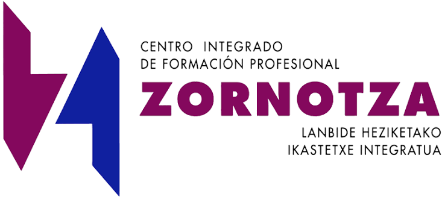

# Reto · Proyecto intermodular · DAW (2.º de DAW)

**CIFP Zornotza LHII · curso 2026-27 · módulo 0616 Proyecto intermodular (Proyecto de desarrollo de aplicaciones web) · 50 h · grado superior**

**Euskaraz:** [irakurri behean ↓](#euskaraz)

> Este repositorio es el enunciado del reto. Lo que construyáis se publica en la web de proyectos del centro:
> [`CIFPZornotzaLHII/proyectos_intermodulares`](https://github.com/CIFPZornotzaLHII/proyectos_intermodulares).

## Índice

- [Qué es el proyecto intermodular](#qué-es-el-proyecto-intermodular)
- [El reto](#el-reto)
- [Qué tiene que entregar cada grupo](#qué-tiene-que-entregar-cada-grupo)
  - [Cómo se publica](#cómo-se-publica)
- [Fases y horas (50 h del módulo)](#fases-y-horas-50-h-del-módulo)
- [Evaluación](#evaluación)
- [Ideas](#ideas)
- [Plantillas](#plantillas)
- [Normas](#normas)
- [Calendario](#calendario)
- [Repositorios y enlaces](#repositorios-y-enlaces)
- [Euskaraz](#euskaraz)

## Qué es el proyecto intermodular

Es el módulo que une todo lo demás: en vez de aprender una cosa por módulo, cogéis una necesidad real y la
resolvéis usando lo que sabéis de varios módulos a la vez. Se evalúa con los resultados de aprendizaje (RA) del
módulo, que son estos:

| RA | Qué tenéis que demostrar |
|---|---|
| RA1 | Identifica necesidades del sector productivo y las relaciona con proyectos tipo que las puedan satisfacer. |
| RA2 | Diseña un proyecto relacionado con las competencias del título, incluyendo y desarrollando las fases que lo componen. |
| RA3 | Planifica la ejecución del proyecto: plan de intervención y documentación asociada. |
| RA4 | Define los procedimientos de seguimiento y control de la ejecución del proyecto. |

## El reto

Un cliente real o realista (un comercio, una asociación, el propio centro) necesita una aplicación web. Vuestro grupo
identifica la necesidad, diseña la solución, la planifica, construye un **MVP que funciona** y define cómo se hace
el seguimiento y control del proyecto. El MVP tiene que estar desplegado (servidor del aula, Isard o similar) y
ser usable en la demo: registro o login si procede, datos reales o de prueba, al menos un flujo completo de principio
a fin.

El módulo de proyecto no evalúa cuánto código habéis escrito, sino si sabéis llevar un proyecto web de la necesidad al
despliegue: análisis, diseño, plan, ejecución controlada y presentación.

## Qué tiene que entregar cada grupo

- **Landing page** de presentación del proyecto con las seis secciones que se evalúan: necesidad, solución, planificación, demo, seguimiento y control, equipo. Se publica en la web del centro (plantilla en el repo de la web).
- **Tarjeta** en la web de proyectos: la carpeta `proyectos/<ciclo>/<tu-proyecto>/` con `proyecto.json` (título, resumen, equipo, portada, vídeo, repo). La etiqueta de grado la pone la web.
- **Vídeo de presentación de 5 minutos** en el que se ve al equipo hablando y la pantalla, en este orden: solución, planificación, mini demo, seguimiento y control. Se enlaza (YouTube o Drive del centro), no se sube al repo.
- **Documento de planificación** y **registro de seguimiento** (plantillas en [`plantillas/`](plantillas/)), enlazados desde la landing.
- **MVP funcional** relacionado con tu ciclo: algo que se pueda usar de verdad en la demo, aunque sea pequeño. Un prototipo en papel o una presentación no vale.

### Cómo se publica

1. Fork de [`CIFPZornotzaLHII/proyectos_intermodulares`](https://github.com/CIFPZornotzaLHII/proyectos_intermodulares) y clonarlo.
2. Copiar [`proyectos/_plantilla/`](https://github.com/CIFPZornotzaLHII/proyectos_intermodulares/tree/main/proyectos/_plantilla) a `proyectos/WG/<nombre-del-proyecto>/` y rellenar `proyecto.json` y `index.html`.
3. Abrir una **pull request** que solo toque esa carpeta. El robot comprueba las reglas; el profesor la acepta y el servidor se actualiza solo.
4. El vídeo puede llegar en una segunda pull request cuando esté grabado.

Guía paso a paso: [`proyectos/LEEME.md`](https://github.com/CIFPZornotzaLHII/proyectos_intermodulares/blob/main/proyectos/LEEME.md).

## Fases y horas (50 h del módulo)

| Fase | Horas | Qué se hace | Entregable / hito |
|---|---|---|---|
| 0 · Arranque | 2 | Equipos, lectura del reto, elección de idea (de [`IDEAS.md`](IDEAS.md) o propia, aprobada por el profesor) | Equipo e idea registrados |
| 1 · Análisis | 6 | Necesidad real, cliente o sector, cómo se hace ahora, alternativas | Ficha de análisis (sección 1 de la planificación) |
| 2 · Diseño y planificación | 8 | Alcance, requisitos, diseño o arquitectura, tareas con estimación, riesgos, recursos y presupuesto | **Hito 1**: planificación aprobada |
| 3 · Ejecución | 22 | Construir el MVP, integrando lo que se trabaja en los otros módulos. Registro de seguimiento semanal | **Hito 2**: revisión intermedia con demo parcial |
| 4 · Cierre | 8 | Landing, vídeo, pull request, registro de seguimiento final | Proyecto publicado en la web |
| 5 · Defensa | 4 | Presentación ante el equipo docente: vídeo (5 min) + preguntas (5 min) | Defensa |

Las 50 h son las del módulo. El trabajo técnico del MVP se apoya en lo que hacéis en los otros módulos del ciclo (es un proyecto *intermodular*); en estas horas se analiza, planifica, integra, documenta, publica y defiende.
Las fechas concretas de cada hito las fija el profesor al inicio del curso y se anotan en [`CALENDARIO.md`](CALENDARIO.md).

## Evaluación

La nota sale de la rúbrica de [`EVALUACION.md`](EVALUACION.md): planificación, ejecución (MVP), seguimiento y control, publicación (landing y tarjeta) y vídeo + defensa. Cada RA está asociado a uno o varios entregables, así que si falta un entregable, falta un RA.

## Ideas

Veinte ideas de partida, pensadas con las tecnologías que trabajáis en el ciclo, en [`IDEAS.md`](IDEAS.md). Podéis
proponer otra: la condición es que tenga un cliente o necesidad identificable y que se pueda construir un MVP en el tiempo del módulo.

## Plantillas

- [`plantillas/planificacion.md`](plantillas/planificacion.md): documento de planificación (análisis, alcance, tareas, riesgos, presupuesto).
- [`plantillas/seguimiento.md`](plantillas/seguimiento.md): registro semanal de seguimiento y control.
- [`plantillas/guion-video.md`](plantillas/guion-video.md): guion del vídeo de 5 minutos.

## Normas

- **Equipos** de 2 o 3 personas. Cada persona tiene tareas asignadas y visibles en la planificación: en la defensa se pregunta a cada uno por lo suyo.
- **Honestidad en el seguimiento.** Un plan que "salió perfecto" sin desviaciones es sospechoso. Se valora detectar el problema, decidir y dejarlo escrito.
- **Inteligencia artificial.** Se puede usar para investigar, redactar y programar, con dos condiciones: se indica dónde se ha usado y tenéis que ser capaces de explicar y modificar lo que entreguéis. En la defensa se comprueba.
- **Plagio.** Copiar un proyecto ajeno (o entregar algo que no entendéis) suspende el módulo.
- **Vídeos y ficheros grandes** no se suben al repositorio: se enlazan.
- **Idioma.** Landing, vídeo y defensa en el idioma del grupo (castellano o euskera); la terminología técnica en inglés se usa con naturalidad (RA de comunicación).

## Calendario

Fechas de cada hito en [`CALENDARIO.md`](CALENDARIO.md) (las fija el profesor al inicio del curso).

## Repositorios y enlaces

| Enlace | Qué hay |
|---|---|
| [`reto_intermodular_2sm`](https://github.com/CIFPZornotzaLHII/reto_intermodular_2sm) | Reto de SMR (2SM) |
| [`reto_intermodular_wg`](https://github.com/CIFPZornotzaLHII/reto_intermodular_wg) | Reto de DAW (WG): **este repositorio** |
| [`reto_intermodular_pg`](https://github.com/CIFPZornotzaLHII/reto_intermodular_pg) | Reto de DAM (PG) |
| [`proyectos_intermodulares`](https://github.com/CIFPZornotzaLHII/proyectos_intermodulares) | La web de proyectos del centro, donde cada grupo publica el suyo |
| [`proyectos/LEEME.md`](https://github.com/CIFPZornotzaLHII/proyectos_intermodulares/blob/main/proyectos/LEEME.md) | Guía paso a paso para publicar el proyecto en la web |
| [`proyectos/_plantilla/`](https://github.com/CIFPZornotzaLHII/proyectos_intermodulares/tree/main/proyectos/_plantilla) | Plantilla de la carpeta del proyecto (tarjeta y landing) |
| [`proyectos/WG/`](https://github.com/CIFPZornotzaLHII/proyectos_intermodulares/tree/main/proyectos/WG) | Los proyectos de DAW publicados en la web |
| [`CALENDARIO.md`](CALENDARIO.md) · [`EVALUACION.md`](EVALUACION.md) · [`IDEAS.md`](IDEAS.md) · [`plantillas/`](plantillas/) | Fechas, rúbrica, ideas y plantillas de este reto |

---

# Erronka · Proiektu intermodularra · DAW (DAWko 2. maila)

**CIFP Zornotza LHII · 2026-27 ikasturtea · 0616 modulua, Proiektu intermodularra (Web aplikazioen garapeneko proiektua) · 50 h · goi maila**

**Castellano:** [leer arriba ↑](#castellano)

> Errepositorio hau erronkaren enuntziatua da. Eraikitzen duzuena ikastetxeko proiektuen webgunean argitaratzen da:
> [`CIFPZornotzaLHII/proyectos_intermodulares`](https://github.com/CIFPZornotzaLHII/proyectos_intermodulares).
> Erronkaren gainerako fitxategiak (egutegia, ebaluazioa, ideiak eta txantiloiak) gaztelaniaz daude.

## Aurkibidea

- [Zer da proiektu intermodularra](#zer-da-proiektu-intermodularra)
- [Erronka](#erronka)
- [Talde bakoitzak zer entregatu behar duen](#talde-bakoitzak-zer-entregatu-behar-duen)
  - [Nola argitaratzen da](#nola-argitaratzen-da)
- [Faseak eta orduak (moduluaren 50 h)](#faseak-eta-orduak-moduluaren-50-h)
- [Ebaluazioa](#ebaluazioa)
- [Ideiak](#ideiak)
- [Txantiloiak](#txantiloiak)
- [Arauak](#arauak)
- [Egutegia](#egutegia)
- [Errepositorioak eta estekak](#errepositorioak-eta-estekak)

## Zer da proiektu intermodularra

Gainerako guztia lotzen duen modulua da: modulu bakoitzean gauza bat ikasi beharrean, benetako behar bat hartu eta
hainbat modulutan dakizuena aldi berean erabiliz konpontzen duzue. Moduluaren ikaskuntza-emaitzekin (IE) ebaluatzen
da, hauekin:

| IE | Zer erakutsi behar duzuen |
|---|---|
| IE1 | Ekoizpen-sektoreko beharrak identifikatzen ditu eta behar horiek ase ditzaketen proiektu-motekin lotzen ditu. |
| IE2 | Tituluaren gaitasunekin lotutako proiektu bat diseinatzen du, proiektua osatzen duten faseak barne hartuta eta garatuta. |
| IE3 | Proiektuaren exekuzioa planifikatzen du: esku-hartze plana eta lotutako dokumentazioa. |
| IE4 | Proiektuaren exekuzioaren jarraipen- eta kontrol-prozedurak definitzen ditu. |

## Erronka

Benetako bezero batek edo errealista batek (denda batek, elkarte batek, ikastetxeak berak) web aplikazio bat behar du.
Zuen taldeak beharra identifikatzen du, irtenbidea diseinatzen du, planifikatzen du, **funtzionatzen duen MVP bat**
eraikitzen du eta proiektuaren jarraipena eta kontrola nola egiten diren definitzen du. MVPak hedatuta egon behar du
(ikasgelako zerbitzaria, Isard edo antzekoa) eta demoan erabilgarri izan: erregistroa edo logina, behar bada, benetako
datuak edo probakoak, eta gutxienez hasieratik amaierarainoko fluxu oso bat.

Proiektu-moduluak ez du ebaluatzen zenbat kode idatzi duzuen, baizik eta web proiektu bat beharretik hedapenera
eramaten badakizuen: analisia, diseinua, plana, exekuzio kontrolatua eta aurkezpena.

## Talde bakoitzak zer entregatu behar duen

- **Landing page** bat proiektua aurkezteko, ebaluatzen diren sei atalekin: beharra, irtenbidea, plangintza, demoa, jarraipena eta kontrola, taldea. Ikastetxeko webgunean argitaratzen da (txantiloia webaren errepositorioan dago).
- **Txartela** proiektuen webgunean: `proyectos/<zikloa>/<zuen-proiektua>/` karpeta, `proyecto.json` fitxategiarekin (izenburua, laburpena, taldea, azala, bideoa, errepositorioa). Mailaren etiketa webak jartzen du.
- **5 minutuko aurkezpen-bideoa**, taldea hizketan eta pantaila ikusten direla, ordena honetan: irtenbidea, plangintza, mini demoa, jarraipena eta kontrola. Estekatu egiten da (YouTube edo ikastetxeko Drivea), ez da errepositoriora igotzen.
- **Plangintza-dokumentua** eta **jarraipen-erregistroa** (txantiloiak [`plantillas/`](plantillas/) karpetan), landingetik estekatuta.
- **MVP funtzionala**, zuen zikloarekin lotua: demoan benetan erabil daitekeen zerbait, txikia izan arren. Paperezko prototipo bat edo aurkezpen bat ez da nahikoa.

### Nola argitaratzen da

1. Egin [`CIFPZornotzaLHII/proyectos_intermodulares`](https://github.com/CIFPZornotzaLHII/proyectos_intermodulares) errepositorioaren fork-a eta klonatu.
2. Kopiatu [`proyectos/_plantilla/`](https://github.com/CIFPZornotzaLHII/proyectos_intermodulares/tree/main/proyectos/_plantilla) `proyectos/WG/<proiektuaren-izena>/` karpetara, eta bete `proyecto.json` eta `index.html`.
3. Ireki karpeta hori bakarrik ukitzen duen **pull request** bat. Robotak arauak egiaztatzen ditu; irakasleak onartzen du eta zerbitzaria bere kabuz eguneratzen da.
4. Bideoa bigarren pull request batean irits daiteke, grabatuta dagoenean.

Urratsez urratseko gida (gaztelaniaz): [`proyectos/LEEME.md`](https://github.com/CIFPZornotzaLHII/proyectos_intermodulares/blob/main/proyectos/LEEME.md).

## Faseak eta orduak (moduluaren 50 h)

| Fasea | Orduak | Zer egiten da | Entregagarria / mugarria |
|---|---|---|---|
| 0 · Abiaraztea | 2 | Taldeak, erronka irakurtzea, ideia aukeratzea ([`IDEAS.md`](IDEAS.md) fitxategitik edo propioa, irakasleak onartuta) | Taldea eta ideia erregistratuta |
| 1 · Analisia | 6 | Benetako beharra, bezeroa edo sektorea, orain nola egiten den, alternatibak | Analisi-fitxa (plangintzaren 1. atala) |
| 2 · Diseinua eta plangintza | 8 | Irismena, eskakizunak, diseinua edo arkitektura, zereginak estimazioarekin, arriskuak, baliabideak eta aurrekontua | **1. mugarria**: plangintza onartuta |
| 3 · Exekuzioa | 22 | MVPa eraiki, beste moduluetan lantzen dena integratuz. Asteko jarraipen-erregistroa | **2. mugarria**: tarteko berrikuspena, demo partzialarekin |
| 4 · Itxiera | 8 | Landinga, bideoa, pull requesta, azken jarraipen-erregistroa | Proiektua webean argitaratuta |
| 5 · Defentsa | 4 | Irakasle-taldearen aurrean aurkeztea: bideoa (5 min) + galderak (5 min) | Defentsa |

50 orduak moduluarenak dira. MVParen lan teknikoa zikloko beste moduluetan egiten duzuenean oinarritzen da (proiektu *intermodularra* da); ordu hauetan aztertu, planifikatu, integratu, dokumentatu, argitaratu eta defendatu egiten da.
Mugarri bakoitzaren data zehatzak irakasleak finkatzen ditu ikasturtearen hasieran, eta [`CALENDARIO.md`](CALENDARIO.md) fitxategian idazten dira.

## Ebaluazioa

Nota [`EVALUACION.md`](EVALUACION.md) fitxategiko errubrikatik ateratzen da: plangintza, exekuzioa (MVPa), jarraipena eta kontrola, argitalpena (landinga eta txartela) eta bideoa + defentsa. IE bakoitza entregagarri bati edo batzuei lotuta dago; beraz, entregagarri bat falta bada, IE bat falta da.

## Ideiak

Hasierako hogei ideia, zikloan lantzen dituzuen teknologiekin pentsatuta, [`IDEAS.md`](IDEAS.md) fitxategian. Beste
bat proposa dezakezue: baldintza da bezero edo behar identifikagarri bat izatea eta moduluaren denboran MVP bat eraiki ahal izatea.

## Txantiloiak

- [`plantillas/planificacion.md`](plantillas/planificacion.md): plangintza-dokumentua (analisia, irismena, zereginak, arriskuak, aurrekontua).
- [`plantillas/seguimiento.md`](plantillas/seguimiento.md): asteko jarraipen- eta kontrol-erregistroa.
- [`plantillas/guion-video.md`](plantillas/guion-video.md): 5 minutuko bideoaren gidoia.

## Arauak

- **Taldeak**: 2 edo 3 pertsona. Pertsona bakoitzak zeregin esleituak ditu, plangintzan ikusgai: defentsan bakoitzari berea galdetzen zaio.
- **Zintzotasuna jarraipenean.** Desbideratzerik gabe "primeran atera den" plana susmagarria da. Arazoa hautematea, erabakitzea eta idatziz uztea baloratzen da.
- **Adimen artifiziala.** Ikertzeko, idazteko eta programatzeko erabil daiteke, bi baldintzarekin: non erabili den adierazten da, eta entregatzen duzuena azaltzeko eta aldatzeko gai izan behar duzue. Defentsan egiaztatzen da.
- **Plagioa.** Beste baten proiektua kopiatzeak (edo ulertzen ez duzuen zerbait entregatzeak) modulua ez gainditzea dakar.
- **Bideoak eta fitxategi handiak** ez dira errepositoriora igotzen: estekatu egiten dira.
- **Hizkuntza.** Landinga, bideoa eta defentsa taldearen hizkuntzan (gaztelaniaz edo euskaraz); ingelesezko terminologia teknikoa naturaltasunez erabiltzen da (komunikazioaren IE).

## Egutegia

Mugarri bakoitzaren datak [`CALENDARIO.md`](CALENDARIO.md) fitxategian daude (irakasleak finkatzen ditu ikasturtearen hasieran).

## Errepositorioak eta estekak

| Esteka | Zer dago |
|---|---|
| [`reto_intermodular_2sm`](https://github.com/CIFPZornotzaLHII/reto_intermodular_2sm) | SMRko erronka (2SM) |
| [`reto_intermodular_wg`](https://github.com/CIFPZornotzaLHII/reto_intermodular_wg) | DAWko erronka (WG): **errepositorio hau** |
| [`reto_intermodular_pg`](https://github.com/CIFPZornotzaLHII/reto_intermodular_pg) | DAMeko erronka (PG) |
| [`proyectos_intermodulares`](https://github.com/CIFPZornotzaLHII/proyectos_intermodulares) | Ikastetxeko proiektuen webgunea, talde bakoitzak berea argitaratzen duen tokia |
| [`proyectos/LEEME.md`](https://github.com/CIFPZornotzaLHII/proyectos_intermodulares/blob/main/proyectos/LEEME.md) | Proiektua webean argitaratzeko urratsez urratseko gida |
| [`proyectos/_plantilla/`](https://github.com/CIFPZornotzaLHII/proyectos_intermodulares/tree/main/proyectos/_plantilla) | Proiektuaren karpetaren txantiloia (txartela eta landinga) |
| [`proyectos/WG/`](https://github.com/CIFPZornotzaLHII/proyectos_intermodulares/tree/main/proyectos/WG) | Webean argitaratutako DAWko proiektuak |
| [`CALENDARIO.md`](CALENDARIO.md) · [`EVALUACION.md`](EVALUACION.md) · [`IDEAS.md`](IDEAS.md) · [`plantillas/`](plantillas/) | Erronka honen datak, errubrika, ideiak eta txantiloiak |
